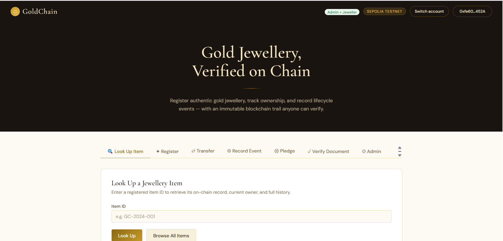
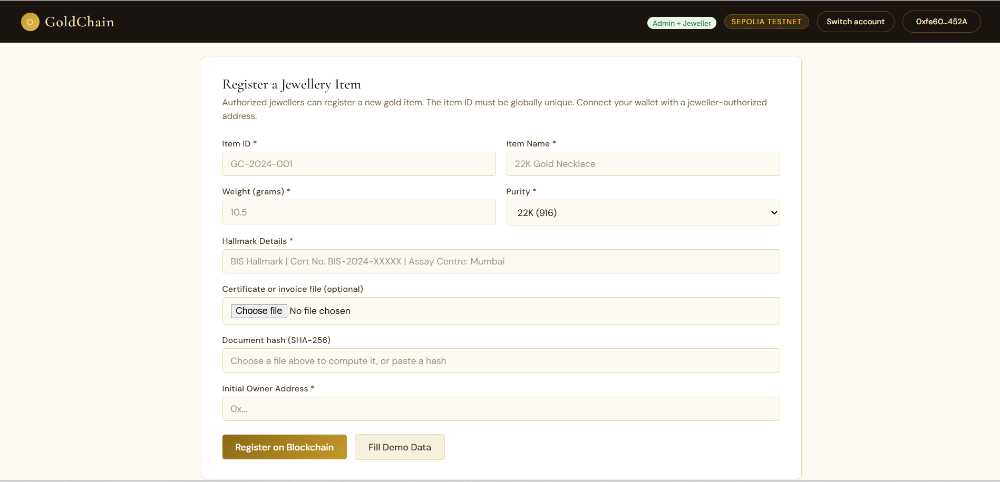
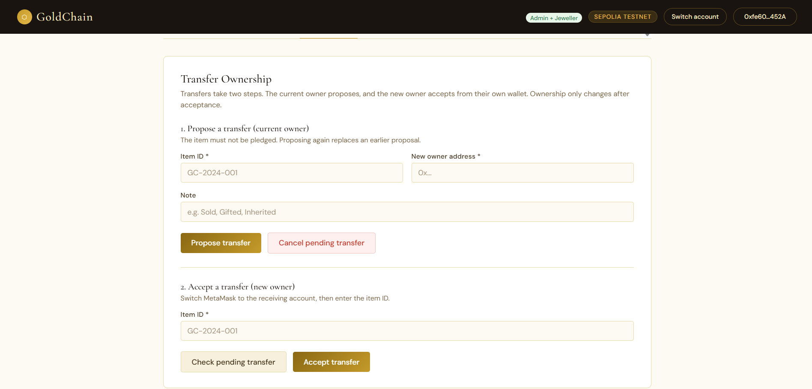
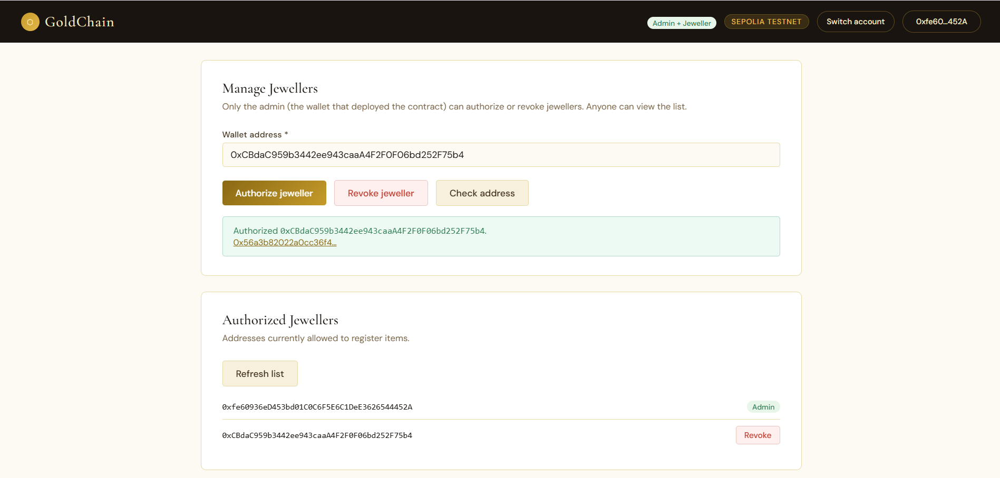
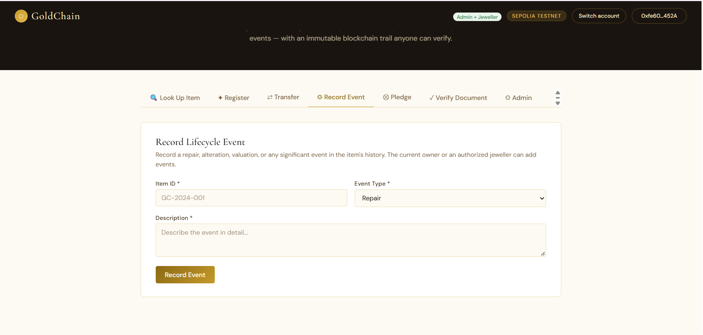
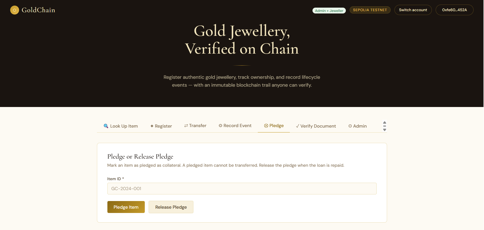

# GoldChain — Deployment & Usage Guide

A DApp for gold jewellery authentication and ownership tracking on the Ethereum Sepolia testnet.



---

## Table of Contents

1. [Project Structure](#project-structure)
2. [Step 1 — Deploy the Smart Contract](#step-1--deploy-the-smart-contract-remix-ide)
3. [Step 2 — Configure the Frontend](#step-2--configure-the-frontend)
4. [Step 3 — Run the Frontend](#step-3--run-the-frontend)
5. [Step 4 — Using GoldChain](#step-4--using-goldchain)
6. [Suggested Demo Flow](#suggested-demo-flow-two-accounts)
7. [Smart Contract — Function Reference](#smart-contract--function-reference)
8. [Technology Stack](#technology-stack)
9. [Troubleshooting](#troubleshooting)
10. [Academic Notes](#academic-notes)

---

## Project Structure

```
GoldChain/
├── Contracts/
│   └── GoldChain.sol        ← Solidity smart contract
├── frontend/
│   └── index.html           ← Complete single-file DApp frontend
├── Screenshots/
│   ├── Home.png
│   ├── Register.png
│   ├── look up.png
│   ├── Transfer.png
│   ├── Lifecycle.png
│   ├── pledge.png
│   └── admin.png
└── README.md                ← This file
```

---

## Step 1 — Deploy the Smart Contract (Remix IDE)

### 1.1  Open Remix
Go to **https://remix.ethereum.org** in your browser.

### 1.2  Create the contract file
- In the **File Explorer** panel (left sidebar), click the **+** icon to create a new file.
- Name it `GoldChain.sol`.
- Paste the full contents of `Contracts/GoldChain.sol` into the editor.

### 1.3  Compile
- Click the **Solidity Compiler** tab (shield icon).
- Set compiler version to **0.8.19** or higher (≥ 0.8.0 works).
- Click **Compile GoldChain.sol**.
- Confirm there are no errors.

### 1.4  Connect MetaMask to Sepolia
- Open MetaMask → click the network dropdown → select **Sepolia Test Network**.
- If Sepolia is not listed: Settings → Networks → Add a network → search "Sepolia".
- Get free test ETH from **https://sepoliafaucet.com** (need ~0.01 ETH for deployment).

### 1.5  Deploy
- Click the **Deploy & Run Transactions** tab (Ethereum logo).
- Under **Environment**, choose **Injected Provider - MetaMask**.
- MetaMask will ask you to connect — approve it.
- Make sure the **Contract** dropdown shows `GoldChain`.
- Click **Deploy** → Confirm the transaction in MetaMask.
- Wait for the transaction to confirm (~15–30 seconds on Sepolia).

### 1.6  Copy your contract address
- After deployment, expand the deployed contract in the **Deployed Contracts** section.
- Copy the contract address (e.g. `0xAbCd...1234`).
- You can also verify it on **https://sepolia.etherscan.io**.

---

## Step 2 — Configure the Frontend

Open `frontend/index.html` in a text editor.

Find this line near the top of the `<script>` block:

```javascript
const CONTRACT_ADDRESS = "0x0000000000000000000000000000000000000000"; // ← Replace after deploy
```

Replace the placeholder with your deployed contract address:

```javascript
const CONTRACT_ADDRESS = "0xYourContractAddressHere";
```

Save the file.

---

## Step 3 — Run the Frontend

### Option A — Open directly (simplest)
Just open `frontend/index.html` in a browser. Modern browsers allow `file://` with MetaMask.

### Option B — Local server (recommended)
```bash
# Python 3
cd GoldChain/frontend
python3 -m http.server 8080
# Visit: http://localhost:8080
```

```bash
# Node.js
npx serve frontend/
```

---

## Step 4 — Using GoldChain

### Connect Your Wallet
- Click **Connect Wallet** in the top-right corner.
- MetaMask will prompt you to connect and switch to Sepolia.
- Your truncated address appears once connected.
- Your role (Admin / Jeweller / Owner) is detected automatically.


> **Note:** The deployer address is automatically set as `admin` and an authorized jeweller.

---

### Register a Jewellery Item (Jeweller only)
1. Click the **Register** tab.
2. Click **Fill Demo Data** to auto-populate a sample — or enter your own:
   - **Item ID**: Unique identifier (e.g. `GC-2024-001`)
   - **Name**: Human-readable label (e.g. `22K Gold Necklace`)
   - **Weight**: In grams (e.g. `14.250`)
   - **Purity**: Select from dropdown
   - **Hallmark**: Certificate details
   - **Document Hash**: SHA-256 hash of physical certificate (optional)
   - **Initial Owner**: Ethereum address of first owner
3. Click **Register on Blockchain** → confirm in MetaMask.



---

### Look Up an Item (Public)
1. Click the **Look up** tab.
2. Enter the Item ID and click **Look Up**.
3. The full record appears: weight, purity, owner, hallmark, pledge status, ownership history, and lifecycle events.
4. Click **Browse All Items** to list every registered item.


---

### Transfer Ownership (two steps)
Transfers need both parties, so a wrong or unwilling address can never receive an item.
1. **Propose** (current owner): open the **Transfer** tab, enter the Item ID, the new owner's address and a note, then click **Propose transfer**.
2. **Accept** (new owner): switch MetaMask to the receiving account, open the same tab, enter the Item ID, and click **Accept transfer**. **Check pending transfer** shows what is waiting for you.
3. The owner can click **Cancel pending transfer** at any time before acceptance.
4. Pledged items cannot be proposed or accepted. A pending proposal also appears as a banner on the item's lookup page.



---

### Verify a Document (anyone)
1. Register an item with a certificate: in the **Register** tab, choose the file and the SHA-256 hash is filled in automatically.
2. Open **Verify Document**, enter the Item ID and choose the file you hold.
3. The file is hashed in your browser (never uploaded) and compared with the on-chain hash. You get **Match**, **Does not match**, or **No document registered**.
4. Try it with the original file, then with a copy that has one character changed, to show tamper detection.

> Hashing uses the browser's `crypto.subtle`, which needs a secure context. Use `http://localhost` (Step 3, Option B) rather than double-clicking the file.

---

### Manage Jewellers (admin only)
Open **Admin**. The admin wallet can authorize or revoke jeweller addresses and see the current list. **Check address** works for anyone. The admin cannot be revoked.



---

### Record a Lifecycle Event (Owner or Jeweller)
1. Click the **Record Event** tab.
2. Enter the Item ID, select an event type (repair, alteration, etc.), and add a description.
3. Click **Record Event** → confirm in MetaMask.



---

### Pledge / Release Pledge (Current Owner only)
1. Click the **Pledge** tab.
2. Enter the Item ID.
3. Click **Pledge Item** to mark it as pledged, or **Release Pledge** to clear it.



---

## Suggested Demo Flow (two accounts)
1. Account 1 deploys, then registers an item with a certificate file and Account 2 as owner.
2. **Verify Document**: the original file matches, an edited copy does not.
3. Account 2 proposes a transfer to Account 1. The lookup page shows the pending banner.
4. Switch to Account 1 and accept. The ownership history now shows both steps.
5. **Admin**: authorize Account 2 as a jeweller, then revoke it.

---

## Smart Contract — Function Reference

| Function | Who can call | Purpose |
|---|---|---|
| `registerItem(...)` | Authorized jeweller | Register a new jewellery item |
| `proposeTransfer(...)` | Current owner | Step 1: propose a transfer |
| `acceptTransfer(...)` | Proposed recipient | Step 2: accept and become owner |
| `cancelTransfer(...)` | Current owner | Withdraw a pending proposal |
| `getPendingTransfer(...)` | Anyone (view) | See a pending proposal |
| `getJewellers()` | Anyone (view) | List authorized jewellers |
| `pledgeItem(...)` | Current owner | Mark as pledged collateral |
| `releasePledge(...)` | Current owner | Release the pledge |
| `recordLifecycleEvent(...)` | Owner or jeweller | Record repair/alteration/etc. |
| `getItem(...)` | Anyone (view) | Read item details |
| `getOwnershipHistory(...)` | Anyone (view) | Read ownership chain |
| `getLifecycleHistory(...)` | Anyone (view) | Read lifecycle events |
| `getAllItemIds()` | Anyone (view) | List all registered IDs |
| `authorizeJeweller(address)` | Admin only | Grant jeweller role |
| `revokeJeweller(address)` | Admin only | Revoke jeweller role |

---

## Technology Stack

| Layer | Technology |
|---|---|
| Smart Contract | Solidity 0.8.19 |
| IDE & Deployment | Remix IDE |
| Testnet | Ethereum Sepolia |
| Wallet | MetaMask |
| Frontend | HTML5 / CSS3 / Vanilla JavaScript |
| Blockchain Library | ethers.js v6 (via CDN) |
| Fonts | Google Fonts (Cormorant Garamond + DM Sans) |

---

## Troubleshooting

**"Not an authorized jeweller" error**
Your connected wallet is not authorized. Only the deployer (admin) and addresses added via `authorizeJeweller()` can register items.

**"Item already registered" error**
Each Item ID must be globally unique. Try a different ID.

**"Cannot transfer a pledged item"**
Release the pledge before transferring ownership.

**MetaMask not switching to Sepolia**
Go to MetaMask → Settings → Networks and add Sepolia manually if it's not in the list.

**"Not the intended recipient" when accepting**
Switch MetaMask to the exact address the owner proposed the transfer to.

**Hashing fails or the Verify tab errors**
Serve the page from `http://localhost` instead of opening it as a `file://` path.

**Transaction reverts with no clear reason**
Check that you're calling the function as the correct role (owner vs. jeweller vs. admin).

**Screenshots not showing in the README**
Make sure the `Screenshots/` folder sits next to `README.md` and the file names match exactly (they are case-sensitive on GitHub).

---

## Academic Notes

- This is a **prototype** for academic demonstration on a public testnet.
- No real ETH or gold is involved — Sepolia ETH is worthless test currency.
- Off-chain document storage (PostgreSQL + file storage) is not implemented in this prototype; the `docHash` field stores a reference for future integration.
- Physical gold authenticity still requires in-person hallmark verification; blockchain preserves the associated records, not the physical item.
